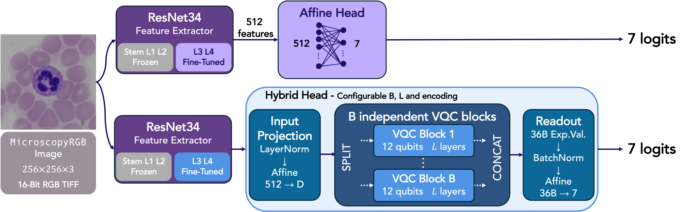

# Hybrid quantum learning for blood-cell classification

This repository provides PyTorch and PennyLane implementations for imbalanced blood-cell classification using ResNet34 backbones with affine or hybrid variational quantum circuit (VQC) heads. The study compares direct ImageNet transfer with intermediate adaptation on MLL23 before training on MicroscopyRGB, and examines encoding strategies, circuit depth, and independent circuit blocks.

The code accompanies the article **Hybrid quantum learning for imbalanced blood-cell classification: domain adaptation and classifier design**, by Gabriele D'Angeli, Cyrill Aebischer, Eryk Schiller, Gianluca Nicchiotti, Su Fong Chien, Jerome Extermann, and Enrico Pomarico.



## Results

MicroscopyRGB contains 821 images in seven classes. Both classifier families use ResNet34 for feature extraction.

In the head comparison, they start from the same MLL23-adapted backbone and fine-tune residual layers 3-4 together with the head.

| Head | Macro-F1 | Balanced accuracy | Trainable head parameters |
| --- | ---: | ---: | ---: |
| Affine | 0.879 $\pm$ 0.008 | 0.889 $\pm$ 0.010 | 3,591 |
| Hybrid B1/L1 | 0.854 $\pm$ 0.013 | 0.876 $\pm$ 0.008 | 19,943 |
| Hybrid B2/L1 | 0.865 $\pm$ 0.010 | 0.886 $\pm$ 0.008 | 38,855 |

Values are mean $\pm$ **standard deviation across seeds 9, 122, and 250**. 

B denotes independent circuit blocks and L the layers per block. Every block in the paper has 12 qubits.

Metrics are computed from pooled five-fold validation predictions separately for each seed. **Each image contributes once per seed.**

Intermediate MLL23 adaptation increases the mean macro-F1 in all four affine-head fine-tuning settings.

## Repository

| Path | Contents |
| --- | --- |
| `scripts/train.py` | Training, validation, checkpoint selection, and CV aggregation |
| `scripts/config.py` | Command-line options and environment-variable loading |
| `scripts/data/` | Dataset loaders, class filtering, augmentation, and stratified splitting |
| `scripts/models/classifiers.py` | Affine ResNet models, backbone loading, and end-to-end wrapper |
| `scripts/models/hybrid.py` | ResNet-VQC heads and additional model implementations |
| `scripts/models/losses.py` | Focal loss used for intermediate adaptation |
| `scripts/utils/metrics.py` | Aggregate and per-class classification metrics |
| `notebooks/MLL23_dataset_analysis.ipynb` | MLL23 dataset analysis |
| `paper/figures/` | Figures included in the article |
| `requirements.txt` | |

## Installation

Use **Python 3.11 or newer**: the declared minimum PennyLane version, 0.44.1, requires Python >=3.11. Install a compatible PyTorch/torchvision pair for your platform and CUDA environment.

From the repository root, in an activated virtual environment:

```text
python -m pip install -r requirements.txt
python scripts/train.py --help
```

PennyLane **`lightning.gpu` with adjoint differentiation** and NVIDIA GPUs require the `pennylane-lightning-gpu` package and compatible NVIDIA CUDA/cuQuantum libraries.

Backend selection is automatic: `lightning.gpu` -> `lightning.qubit` -> `default.qubit`. The first two use adjoint differentiation, the last uses backpropagation.

The optional MLL23 analysis notebook additionally requires Jupyter, pandas, and seaborn:

```text
python -m pip install jupyterlab pandas seaborn
```

## Data

Datasets are obtained separately from their original sources:

- **Raw-Microscopy**, the source dataset for the MicroscopyRGB representation used here: [dataset DOI](https://doi.org/10.5281/zenodo.5235536) and [associated publication](https://openreview.net/forum?id=I4IkGmgFJz).
- **MLL23:** [Zenodo dataset](https://zenodo.org/records/14277609), with 41,621 images across 18 classes.

### MicroscopyRGB

The loader expects an already prepared RGB dataset with this layout:

```text
/path/to/microscopy/
  images/
    rgb_scale100/
      <image-stem>.tiff
      ...
  labels/
    Ma190c_annotations.dat
```

The image stems must match the annotations. Both `.tiff` and `.tif` are accepted. The paper uses 256 x 256 RGB images.

Channel normalisation then uses mean `(0.5566, 0.4607, 0.5923)` and standard deviation `(0.0983, 0.1417, 0.0667)`.

| Label | Cell type | Sample count |
| --- | --- | ---: |
| BAS | Basophil | 18 |
| EOS | Eosinophil | 43 |
| KSC | Smudge cell | 158 |
| LYA | Atypical lymphocyte | 30 |
| LYT | Typical lymphocyte | 224 |
| MON | Monocyte | 180 |
| NGS | Segmented neutrophil | 168 |
| **Total** | | **821** |

The article describes excluding 30 UNC images, eight NGB images, and 81 manually identified duplicates from 940 images. 

The original loader excludes one explicitly named corrupt image and applies class/file-presence filters.


### MLL23

Extract the class archives into a common root so that images are directly inside their class directories:

```text
/path/to/MLL23/
  basophil/
    <image>.TIF
  eosinophil/
    <image>.TIF
  ...
  smudge_cell/
    <image>.TIF
```

The 18 MLL23 class directory names are listed in `MLL23_CLASSES` in `scripts/data/dataset.py`.

Normalisation uses mean `(0.7551, 0.6655, 0.7923)` and standard deviation `(0.1992, 0.2667, 0.1737)`.

Use `--data_dir` explicitly, or define `MICROSCOPY_ROOT` and `MLL23_DATA_DIR` in a root-level `.env` file. The latter is ignored by Git. Paths supplied through `--data_dir` take precedence.

## Outputs and tracking

When checkpoint saving is enabled, outputs are written relative to the working directory:

```text
results/<dataset>/<timestamp-and-run-name>/fold_<n>/
  run_config.txt
  best_model.pth           # --save_model
  backbone.pth             # --save_backbone
  backbone_metadata.json   # --save_backbone
```

Full model files contain a `state_dict`; backbone files contain backbone-only tensors. The CLI's `--backbone_weights` option loads the latter. There is no general ResNet/VQC full-checkpoint reload argument: `--eval_only` alone does not restore `best_model.pth`.

W&B logging is enabled unless `--no_wandb` is supplied. 

To use your own account, remove that flag, authenticate with W&B, and pass `--wandb_project YOUR_PROJECT` and, when appropriate, `--wandb_entity YOUR_ENTITY`. The article links [this W&B project](https://wandb.ai/gabriele-dangeli2-hes-so-secqdevops/MicroscopyRGB_Classification).

For `kfold`, the CV summary run computes metrics from the concatenated best-epoch validation predictions. It logs pooled metrics, a confusion matrix, and per-class metrics to W&B. 

The code processes one seed at a time.

## Citation and licence

Please cite the article by its title and authors above.

The software is released under the [MIT licence](LICENSE). 
